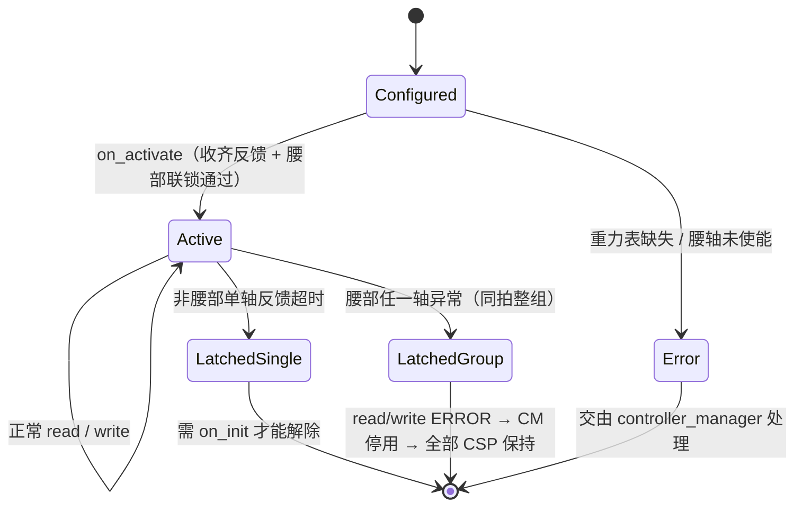

# Juxie ROS2 Control

ROS2 Control 硬件接口，通过 CAN FD 控制 JX 电机。

## 功能特性

- 支持 CAN FD 通信（1Mbps 仲裁段，5Mbps 数据段）
- 支持最多 8 个电机同时控制
- 支持 CSP 位置、CSV 速度及电流环模式，可按电机配置
- 提供位置、速度及电流反馈

## 硬件接口

### 命令接口（Command Interfaces）
- `position`: 位置命令或位置参考（弧度）
- `velocity`: CSV 速度命令或电流环速度参考（弧度/秒）

### 状态接口（State Interfaces）
- `position`: 关节实际位置（弧度）
- `velocity`: 关节实际速度（弧度/秒）
- `effort`: 电机 Iq 电流（mA）

## 编译

```bash
cd ~/ros2_ws
colcon build --packages-up-to juxie_ros2_control --symlink-install
source install/setup.bash
```

## 配置参数

在 ROS2 Control 配置中需要设置以下硬件参数：

- `can_interface` (string, 默认: `"can0"`): CAN 接口名称
- `motor_ids` (string, 必需): 电机 ID 列表，格式为 `"1,2,3"` 或 `"[1,2,3]"`
- `control_period_ms` (int, 默认: `1`): 控制周期（毫秒），默认 1ms = 1000Hz
- `max_position_step_nct` (int, 默认: `25`): 每个发送周期允许的最大位置增量（nct）。
- `max_position_accel_nct` (int, 默认: `5`): 相邻两帧指令速度(delta)的最大变化量（nct/cycle²），用于加减速兜底；

## 使用示例

### 1. 在 URDF/Xacro 中配置硬件接口

在您的机器人描述文件中添加 ROS2 Control 配置：

```xml
<?xml version="1.0"?>
<robot name="my_robot" xmlns:xacro="http://www.ros.org/wiki/xacro">

  <!-- 定义关节接口 -->
  <ros2_control name="juxie_system" type="system">
    <hardware>
      <plugin>juxie_ros2_control/JxHardware</plugin>
      <!-- CAN 接口配置 -->
      <param name="can_interface">can0</param>
      <!-- 电机 ID 列表（最多 8 个） -->
      <param name="motor_ids">1,2,3</param>
      <!-- 控制周期（毫秒） -->
      <param name="control_period_ms">1</param>
      <!-- 单帧最大位置增量（nct），防位置跃迁 -->
      <param name="max_position_step_nct">25</param>
      <param name="max_position_accel_nct">5</param>
    </hardware>

    <!-- 关节接口定义 -->
    <joint name="joint1">
      <command_interface name="position"/>
      <state_interface name="position">
        <param name="initial_value">0.0</param>
      </state_interface>
      <state_interface name="velocity"/>
    </joint>

    <joint name="joint2">
      <command_interface name="position"/>
      <state_interface name="position">
        <param name="initial_value">0.0</param>
      </state_interface>
      <state_interface name="velocity"/>
    </joint>

    <joint name="joint3">
      <command_interface name="position"/>
      <state_interface name="position">
        <param name="initial_value">0.0</param>
      </state_interface>
      <state_interface name="velocity"/>
    </joint>
  </ros2_control>

</robot>
```

### 2. 配置 CAN 接口

#### 配置步骤

1. **编辑 sudoers 文件**

```bash
sudo visudo
```

2. **添加以下行**（将 `your_username` 替换为你的实际用户名，将 `can0` 为默认配置的设备名称）

```
your_username ALL=(ALL) NOPASSWD: /sbin/ip link set can0 down, /sbin/ip link set can0 up type can bitrate * dbitrate * fd on

```

**示例**（如果用户名为 `fa`，设备名称为 `can0`）：
```
fa ALL=(ALL) NOPASSWD: /sbin/ip link set can0 down, /sbin/ip link set can0 up type can bitrate * dbitrate * fd on
```
### 3. 启动控制器

使用标准的 ROS2 Control 控制器（如 `joint_trajectory_controller`）：

```bash
# 启动机器人描述
ros2 launch your_robot_description display.launch.py

# 启动控制器管理器
ros2 control load_controller joint_state_broadcaster
ros2 control load_controller joint_trajectory_controller

# 激活控制器
ros2 control set_controller_state joint_state_broadcaster active
ros2 control set_controller_state joint_trajectory_controller active
```

### 4. 发送位置命令

```bash
# 使用命令行发送位置命令
ros2 topic pub /joint_trajectory_controller/joint_trajectory \
  trajectory_msgs/msg/JointTrajectory \
  "{joint_names: ['joint1', 'joint2', 'joint3'], \
    points: [{positions: [0.5, -0.5, 1.0], time_from_start: {sec: 2, nanosec: 0}}]}"
```

## 注意事项

1. **电机 ID 顺序**: `motor_ids` 参数中的 ID 顺序必须与 URDF 中定义的关节顺序一致
2. **角度范围**: 电机角度范围为 -180° 到 +180°（-π 到 +π 弧度）
3. **权限要求**: CAN 接口配置需要 root 权限，确保运行节点时具有相应权限
4. **CAN FD 支持**: 确保您的 CAN 适配器支持 CAN FD 模式
5. **控制周期**: 默认 1ms 控制周期，可根据实际需求调整

## 故障排除

- **CAN 接口初始化失败**: 检查 CAN 接口名称是否正确，接口是否已连接
- **电机无响应**: 检查电机 ID 配置是否正确，CAN 总线连接是否正常
- **权限错误**: 确保具有配置 CAN 接口的权限，可能需要使用 sudo 或配置 udev 规则

## 控制模式与电流环原理

`control_mode` 可设为 `position`、`velocity` 或 `current`，并可用 `velocity_motor_ids`、`current_motor_ids` 为指定电机覆盖模式。电流环关节的 `position` / `velocity` 命令作为目标位置 `q_d` / 目标速度 `q̇_d`，驱动按以下关系计算目标 Iq 电流：

```text
I = Kp(q_d - q) + Kd(q̇_d - q̇) + gravity_ff + friction_ff + offset
```

其中 `Kp`、`Kd`、摩擦项、偏置和固定重力前馈使用 `impedance_kp_ma_rad`、`impedance_kd_ma_s_rad`、`friction_*`、`friction_offset_ma` 和 `gravity_feedforward_ma` 配置，电流单位为 mA。控制命令在 `max_current_ma` 限幅；`current_slew_rate_ma_s` 可选限制电流变化率，默认 `0`（关闭）。电流由独立发送线程按 `control_period_ms` 周期计算和发送。

自动重力前馈优先使用未超时的 `gravity_ff_topic` 数据；无有效话题数据时回退到 `gravity_ff_table`。表格通过机身关节 1–3 的角度插值，提供电机 ID 1–4 的电流值。摩擦前馈可选择实测速度或参考速度，并可设置死区和幅值上限。

可选的双臂惯性前馈使用 `<gravity_ff_topic>/dynamic`（同为 Float64MultiArray，按电机 ID − 1
索引，单位 mA）。只在静态重力话题有效、动态数据接收后不超过 20 ms 时叠加到电流环关节，
并乘以重力接管的渐变权重；过期后动态目标归零，不影响静态重力/查表补偿。
短数组或非有限数据整条丢弃，重新激活清空动态缓存。最终输出仍受总电流限幅和变化率限制。
WBC 默认不发布动态前馈，启用与限幅配置见 arms_ros2_control/README_zh.md。

当电机反馈连续异常达到 `feedback_timeout_cycles`，驱动会锁存该电机到 CSP 位置保持请求，并忽略后续命令，直到重新初始化。锁存位置取最后已知反馈；总线故障时不保证请求已送达或电机已执行。

### 控制逻辑总览

#### 1. 模式选择（`on_init` 一次决定）

| 配置来源 | 作用 |
|---|---|
| `control_mode` = `position` / `velocity` / `current` | 所有电机的默认模式 |
| `velocity_motor_ids` | 列表内电机改为 CSV |
| `current_motor_ids` | 列表内电机改为电流环 `CURRENT_TORQUE` |
| 运行期 `latchOneMotorToCspHold()` | 该电机强制改回 CSP，且不自动恢复 |

同一电机不能同时出现在两个列表（初始化报错）。profile 的 `juxie_joint_modes`
由描述包 xacro 翻译成这两个列表，驱动只认列表。

#### 2. 命令口在各模式下的语义

| 模式 | `position` 命令口 | `velocity` 命令口 | 实际下发 |
|---|---|---|---|
| CSP | 位置目标（限速 + 限加速追赶，不越过目标） | 不导出 | 位置（int16 count） |
| CSV | 导出但不参与下发 | rpm 目标（`max_velocity_rpm` 限幅） | 速度 |
| CURRENT | 阻抗参考 `q_d` | 阻抗参考 `q̇_d` | 电流 mA |

`q_ref` / `v_ref` 只被电流环的阻抗律消费，CSP/CSV 轴不维护这两个量。
头部 5–6 轴只有 CSP/CSV，因此不进重力前馈、不进腰部联锁，也不占这两份参考。

#### 3. 每拍时序

```text
controller_manager 循环 @update_rate
  read()  解析 CAN 反馈 → 更新 q/dq/Iq、健康度、联锁；故障则返回 ERROR
  write() 按模式写目标：CSP→target_raw，CSV→rpm，电流环→q_ref/v_ref（锁存轴跳过）
              │
              ▼
驱动发送线程 @control_period_ms（默认 1 ms，独立于 CM 节拍）
  CSP     : target_raw 限速/限加速 → 打包位置
  CSV     : raw_velocity_commands_（write() 已换算成 rpm）→ 打包速度
  CURRENT : 阻抗 + 静态重力(话题/查表渐变) + 动态重力 + 摩擦
            → clamp(max_current_ma) → 变化率限制 → 打包电流
  一帧 CAN FD 内最多 8 个电机槽位一起发出；发送失败先在 100 ms 窗口重试，
  超窗或硬错误 → transmit fault + 全轴锁存
```

#### 4. 运行状态机



### 重力补偿启动过渡

`gravity_ff_transition_s` 默认 `1.0` 秒，必须为非负有限数；`0` 保持直接切换。
有重力表时，首次收到有效话题后按 smoothstep 权重由查表逐渐切到话题：
`I_g = (1-w) * I_table + w * I_topic`。过渡期间继续使用完整重力补偿，
不对总电流从零爬升；过渡完成后话题值不再滤波。
话题超时立即回退查表，再次收到有效话题后重新过渡。
电流环必须配置有效重力表：路径为空、文件不存在或数据不完整时初始化/激活失败，
控制器无法激活；运行中若没有有效的已加载表，则停止下发电流命令并由 read/write
返回 ERROR，交由 controller_manager 停用依赖控制器、执行硬件错误处理并请求 CSP 保持。
文件在初始化和激活时读取，运行时使用内存副本，不每周期访问磁盘。
W2 默认值由描述包 `juxie_joint_impedance.yaml` 提供，可在 profile 的 hardware 段覆盖。

### 腰部电流环整组联锁

当电机 ID 1–4 中任一轴配置为电流环时，整个腰部 1–4 轴按同一承重组检查。
激活前必须收齐反馈，且各腰轴均已使能、抱闸释放、无故障；否则拒绝激活，
不会启动电流发送线程。头部轴不属于腰部联锁组。
腰部电流按完整 4 轴模型计算，少一轴出力时其余轴会欠补偿，因此**任何单轴锁存都会
升级为整组锁存**：包括反馈超时、CAN 发送失败和健康度锁存等所有入口，不允许单轴退出
电流环而其余轴继续按完整模型出力。
运行中任一腰轴未使能、抱闸未释放或反馈超时，整组腰轴锁存 CSP 保持请求，
read/write 返回 ERROR，交由 controller_manager 停用相关控制器。
紧急故障同样触发整组锁存；不会把承重电流直接清零，必须重新初始化才可解除。
CSP 请求并不保证故障电机能够执行：欠压、断电或总线失效仍须硬件抱闸/安全联锁提供支撑。

### 头部轴的处理边界

头部 5–6 轴不承重，因此不进入腰部联锁组，也不参与重力前馈（表只有 4 个 slot）。
它们与腰部共用同一帧 CAN FD，所以安全动作按“是否影响承重”分级：

| 事件 | 腰部 1–4 | 头部 5–6 |
|---|---|---|
| 反馈超时 / 未使能 | 整组锁存 + read/write ERROR | 只锁存该轴（CSP 保持） |
| 帧内 error 位置位 | 停发整帧 + read/write ERROR | 只锁存该轴，**继续发整帧** |
| CAN 发送失败 | 整帧级故障，全部锁存 | 同左（帧发不出去，无法区分） |

头部单轴报错时不停发整帧，是因为腰部电流就靠这一帧下发；为头部停帧等于让腰部失去
重力补偿。反过来，头部锁存后不会再接受新的位置/速度命令，直到重新初始化。
